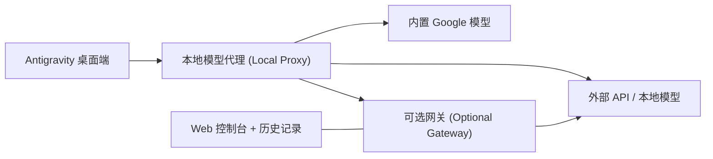

<p align="center">
  
</p>

<h1 align="center">Antigravity Custom Model Enabler</h1>

<p align="center">
  <strong>属于你的服务商。属于你的本地模型。无缝集成于 Antigravity。</strong><br>
  适用于桌面端应用、Antigravity IDE 以及可选网关的模型管理工具。
</p>

<p align="center">
  <a href="https://github.com/vahapogut/antigravity-add-model/actions/workflows/ci.yml"></a>
  <a href="#安装指南"></a>
  <a href="LICENSE"></a>
</p>

<p align="center">
  <a href="README.md">English</a> · <strong>简体中文</strong>
</p>

<p align="center">
  <a href="#安装指南"><strong>快速开始</strong></a> ·
  <a href="#快速链接">快速链接</a> ·
  <a href="#界面截图">界面截图</a> ·
  <a href="#文档指南">文档指南</a> ·
  <a href="https://github.com/vahapogut/antigravity-add-model/issues/new">提交问题 (Issue)</a>
</p>

---

在 Antigravity 内置模型的基础上，无缝添加外部 API 服务商与本地模型。你可以在设置（Settings）中完成配置，直接在对话模型选择器中切换模型，还可以按需通过网关（Gateway）路由请求，从而获得请求历史记录、备用服务商回退（Fallback）以及可视化浏览器控制台等功能。

> [!IMPORTANT]
> **独立的 Electron 桌面端应用**请使用下方的增量安装程序。独立的**基于 VS Code 的 Antigravity IDE** 则使用专属的[设置适配器与本地 Web 管理器](docs/ide.md)。Windows 版 IDE **2.5.5** 的登录、原生模型选择及流式对话功能已通过本地 OpenAI 兼容服务商完成验证；详情请参阅[验证结果说明](docs/ide.md#validation-boundary)。自定义模型路由适用于本地会话，官方原有的 WSL 路由逻辑保持不变。安装前请先查阅[兼容性说明](docs/compatibility.md)。

## 快速链接

| 快速上手 | 配置与连接 | 帮助与项目信息 |
| --- | --- | --- |
| [安装指南](#安装指南) | [可选网关与 Web 控制台](#可选网关与-web-控制台) | [故障排查与恢复](#更新诊断与恢复) |
| [添加你的第一个模型](#添加你的第一个模型) | [从另一台设备连接](#从另一台设备连接) | [受支持的应用版本与目录结构](docs/compatibility.md) |
| [服务商与模型目录](docs/providers.md) | [模型详细配置](docs/configuration.md) | [更新日志 (Changelog)](CHANGELOG.md) |
| [开发与贡献](#开发与贡献) | [Google 账号池设置](docs/configuration.md#google-cloud-code-account-pools) | [浏览现有 Issue](https://github.com/vahapogut/antigravity-add-model/issues) |
| [Antigravity IDE 配置指南](docs/ide.md) | [基于源码的功能特性对比](docs/feature-parity.md) | [IDE 状态检查与还原](docs/ide.md#status-and-recovery) |

## 核心功能

| 功能特性 | 包含内容 |
| --- | --- |
| **模型管理** | 按服务商分组、搜索、编辑、复制、启用/禁用以及模型自动发现。 |
| **连接主流与本地服务商** | 支持 OpenAI、Anthropic、Gemini、OpenRouter、[Cloudflare Workers AI](docs/providers.md#cloudflare-workers-ai) 等兼容 API；支持 Ollama、LM Studio、vLLM 等本地推理服务。 |
| **精细化请求调优** | 协议选择、推理/思考（Reasoning）参数设置、上下文/输出长度限制、自定义请求头、超时控制、自动重试、回退模型（Fallback）及熔断器（Circuit Breaker）。 |
| **Google 账号池支持** | 使用你自己的客户端进行显式 OAuth 登录、加密凭据存储、配额检查、自适应账号轮询以及模型级别的冷却时间管理。 |
| **直连请求诊断** | 内置诊断工具，可查看近期请求、实测延迟/Token 消耗，并提供显式的轻量生成测试。 |
| **连接 Antigravity IDE** | 可逆的设置适配器、托管代理启动器与浏览器端模型管理器；已在 Windows IDE 2.5.5 上配合本地 OpenAI 兼容服务商验证原生模型选择器与流式对话。[查看配置指南](docs/ide.md)。 |
| **保持原生模型选择稳定** | 为模型别名和推理强度变体提供持久、无冲突的 ID，并支持明确的[原生选择器容量管理](docs/ide.md#native-model-identities-and-capacity)。 |
| **配置导入与分享** | 经过校验的 JSON/Base64 导入与导出，自动剔除已保存的敏感凭据以保障安全。 |
| **Web 可视化控制台** | 可选配网关，支持服务商路由、请求/会话历史记录、请求重放、统计图表以及成本估算。 |
| **远程安全连接** | 支持通过 SSH 隧道或配置的网络端点进行带身份验证的远程网关访问。 |

安装程序会完整保留已安装应用的原生运行时，仅注入经过校验的钩子（Hooks）。它会按版本保留独立备份，并在部署失败时自动回滚。有关实现细节与功能范围，请参阅[功能特性对比](docs/feature-parity.md)。

## 界面截图

### 模型管理器 (Model management)

在同一界面中搜索模型、按服务商分组整理，并集中编辑、复制或启用连接。

<p align="center">
  <a href="assets/model_manager.jpg"></a>
</p>

*在独立浏览器演示环境中渲染的当前插件控件及示例模型配置。点击图片可查看原图大小。*

### 模型编辑器 (Model editor)

配置服务商与模型、选择 API 协议格式，或自动探测可用模型。

<p align="center">
  <a href="assets/model_editor.jpg"></a>
</p>

### 远程网关 (Remote gateway)

保存网关连接、导入模型别名，并一键打开管理控制台。

<p align="center">
  <a href="assets/remote_gateway.jpg"></a>
</p>

### 网关控制台 (Gateway dashboard)

在可选的 Web 面板中将模型别名映射到具体服务商，并配置备用回退模型及上下文窗口限制。

<p align="center">
  <a href="assets/model_gateway.jpg"></a>
</p>

*本地测试配置文件中的当前网关界面；图中所示的模型映射关系仅供演示。*

<details>
<summary><strong>桌面端对话模型选择器 — 早期版本预览</strong></summary>

<p align="center">
  
</p>

*早期桌面版本示例。实际显示的模型名称与可用性取决于你配置的服务商。*

</details>

## 安装指南

### 1. 获取项目并构建

你需要安装**独立的 Antigravity 桌面端应用**、Git 以及 **Node.js 22.13 或更高版本**。该 Node 版本同时支持桌面端插件和可选网关。

```sh
git clone https://github.com/vahapogut/antigravity-add-model.git
cd antigravity-add-model
npm ci --ignore-scripts
npm run build
```

已经克隆过仓库？请先拉取最新代码（`git pull`），然后重新运行依赖安装与构建命令。

正在使用 **Antigravity IDE**？请前往阅读 [IDE 配置指南](docs/ide.md)，而无需运行下方的独立版安装命令。IDE 版的基本流程如下：

```sh
npm run ide:check -- --resources "/path/to/Antigravity IDE/resources"
npm run ide:apply -- --resources "/path/to/Antigravity IDE/resources"
npm run proxy:start -- --open
npm run ide:launch -- --resources "/path/to/Antigravity IDE/resources"
```

### 2. 检查并为已安装的应用打补丁

请先完全关闭 Antigravity 及其语言服务器（Language Server）进程。在仓库根目录下运行：

```sh
node scripts/deploy.mjs --check
node scripts/deploy.mjs
```

第一条命令仅检查兼容性，不会修改已安装的文件；第二条命令正式应用插件补丁。部署成功后重新打开 Antigravity 即可。

如果自动检测未能找到你的应用安装位置，请为两条命令指定相同的显式路径：

```sh
node scripts/deploy.mjs --check --resources "/path/to/Antigravity/resources"
node scripts/deploy.mjs --resources "/path/to/Antigravity/resources"
```

`--resources` 参数支持传入 `resources` 目录、应用安装根目录或 macOS 的 `.app` 包路径。在替换任何应用文件之前，安装程序会自动拒绝未知或不兼容的目录结构。

<details>
<summary><strong>各平台封装脚本与可选的 Windows 端点补丁</strong></summary>

各平台封装脚本底层调用同一个安装程序，并支持完全相同的命令行参数。

| 平台 | 封装脚本 |
| --- | --- |
| Windows / PowerShell | `./deploy.ps1` |
| macOS 独立桌面版 | `bash deploy.sh` |
| Linux | `bash deploy_linux.sh` |

部分已识别的 Windows 语言服务器（Language Server）二进制文件会绕过可配置的模型列表端点。针对此类版本，可以检查并应用可选的二进制补丁：

```powershell
.\deploy.ps1 --check --patch-language-server
.\deploy.ps1 --patch-language-server
```

该选项固定占用端口 **50999**，并同样纳入备份与回滚机制中，仅适用于受识别的 Windows 二进制文件。详情请参阅 [Windows 端点补丁说明](docs/compatibility.md#optional-windows-language-server-endpoint-patch)。

</details>

## 添加你的第一个模型

1. 打开 **Settings → Models & Usage**（在较早版本的界面中为 **Models**）。
2. 在 **Custom Models** 区域，点击 **Add model** 并选择一个服务商（Provider）。
3. 根据需要填写 **API URL** 和 **API key**。
4. 使用下方任一方式添加模型，保存后即可在对话窗口的模型选择器中切换使用。

| 添加方式 | 操作步骤 |
| --- | --- |
| **手动输入模型** | 输入准确的 **Provider model ID**（服务商模型 ID），可按需设置显示名称（Display Name），然后依次点击 **Test connection → Save model**。 |
| **从服务商目录中选择** | 点击 **Fetch provider models** 拉取列表，按名称或 ID 搜索，勾选所需模型或点击 **Select filtered**，最后点击 **Add selected**。 |

**在本地运行模型？** 请先启动本地推理服务（如 Ollama 等），然后点击 **Discover local**。本地探测仅在你主动点击时扫描常用端口。

**在多台设备间迁移配置？** 请使用 **Export**（导出）与 **Import**（导入）功能。导出的配置文件会自动剔除 API 密钥、自定义请求头以及 Google 令牌/客户端密钥；请在目标设备上重新输入相应凭据。

> [!NOTE]
> 连接测试成功仅代表模型列表拉取或身份认证通过，并不会实际发起对话生成，也无法证明账户拥有充足的生成配额。对于不提供模型列表查询接口的服务商，依然可以通过手动输入模型 ID 的方式完成配置。

### 支持的服务商与高级选项

| 连接类型 | 预设目录中包含的服务商示例 |
| --- | --- |
| 多模型聚合平台 | OpenRouter、Together AI、Hugging Face Inference Providers、Fireworks AI、SiliconFlow（硅基流动）、Novita AI |
| 官方直连 API | OpenAI、Anthropic、Google Gemini、DeepSeek、Groq、Mistral、xAI、Cerebras、SambaNova、Alibaba Cloud Model Studio（阿里云百炼 / DashScope）、NVIDIA NIM |
| 本地推理服务 | Ollama、LM Studio、llama.cpp、vLLM、LocalAI、TabbyAPI、Text Generation WebUI |
| 其他自定义端点 | LiteLLM、兼容的自定义端点（Custom Endpoint）或带身份认证的模型网关 |

预设项（Presets）会自动填充默认参数；**API format**（API 格式）决定了请求协议的转换方式。具体的模型 ID 与访问权限取决于对应服务商。完整列表可查看[服务商预设目录源码](src/providers.ts)。

**需要接入数百种模型选择？** OpenRouter 等多模型聚合平台支持通过 **Fetch provider models** 实时获取在线模型目录。你可以搜索并勾选所需模型；插件会自动导入可用的上下文/输出长度限制以及视觉（Image）/推理（Reasoning）元数据，同时保留你手动设置的覆盖项。模型目录会随时间动态更新，列出的模型仍需你的账户具备相应访问权限及任务所需能力。详情请参阅[服务商配置与模型发现](docs/providers.md)。

**使用视觉（识图）模型？** 桌面端代理支持将图片输入原生转发至兼容 OpenAI 和 Anthropic 协议的端点（包括支持多模态视觉的 DeepSeek 模型）。关于能力覆盖开关、支持的图片格式与端点要求，请参阅[图片输入配置指南](docs/configuration.md#image-inputs)。

展开 **Advanced settings**（高级设置）可配置请求限制、推理思考参数、自定义请求头、备用回退模型及其他覆盖选项。各字段定义与导入示例请参阅[配置参考文档](docs/configuration.md)。

如需使用 Google 账号池，请选择 **Google Cloud Code account pool** 并按照[账号池配置指南](docs/configuration.md#google-cloud-code-account-pools)操作。你需要提供自己的桌面端 OAuth 客户端（Desktop OAuth Client）；账号与服务的可用资格仍由官方服务商控制。

## 可选网关与 Web 控制台

桌面端插件可以直接连接各模型服务商。当你希望实现集中式路由管理、浏览器端可视化配置、请求历史记录审计或远程端点访问时，可以额外部署网关（Gateway）。

```sh
npm run gateway:install
npm run gateway:build
npm run gateway -- setup --non-interactive
npm run gateway -- start
```

初始化命令（`setup`）会在本地终端打印生成的网关 Token 和控制台登录凭据。在浏览器中打开 **http://127.0.0.1:51001** 并登录，配置服务商凭据与模型别名后保存。

随后在桌面端的 **Remote gateway**（远程网关）对话框中填入：

| 字段 | 本地配置值 |
| --- | --- |
| Gateway URL | `http://127.0.0.1:51000` |
| Gateway token | `setup` 命令打印输出的 Token |
| Dashboard URL | `http://127.0.0.1:51001` |

点击 **Test gateway** 测试连接，然后点击 **Import model aliases** 导入模型别名。导入的模型会直接出现在桌面端的模型选择器中。点击 **Open dashboard** 即可在浏览器中打开已保存的控制台地址。

<details>
<summary><strong>常用网关管理命令</strong></summary>

```sh
npm run gateway -- status
npm run gateway -- logs
npm run gateway -- stop
```

在 Web 控制台中保存的服务商/模型更改会立即热重载生效；监听地址与端口的更改则需要重启网关。历史记录包含提示词（Prompts）、响应内容及工具调用参数；费用统计为估算值。

</details>

### 从另一台设备连接

在能够访问模型服务商的主机上运行网关，然后在客户端设备上通过 SSH 转发这两个端口：

```sh
ssh -N -L 51000:127.0.0.1:51000 -L 51001:127.0.0.1:51001 user@gateway-host
```

保持 SSH 隧道开启，并在客户端上使用上表中的本地回环地址（`127.0.0.1`）即可。默认情况下，网关的两个监听端口均仅绑定到本地回环地址（Loopback）。如需配置显式的局域网/公网监听或 HTTPS 反向代理，请参阅[远程访问指南](gateway/README.md#remote-access)。

## 架构与工作流原理



本插件在保留官方原生运行时的前提下增量注入设置界面控件。可选网关则作为独立的 Node.js 进程运行，并使用其专属的数据目录。

## 更新、诊断与恢复

每当 Antigravity 客户端升级后，请先重新构建插件并再次运行兼容性检查，确认无误后再重新部署。

| 需求场景 | 执行命令 |
| --- | --- |
| 检查构建产物、模型配置与本地服务状态 | `npm run doctor` |
| 以 JSON 格式输出诊断结果 | `npm run doctor -- --json` |
| 检查指定路径下的安装兼容性 | `npm run patch:check -- --resources "/path/to/Resources"` |
| 向受支持的安装目录重新应用插件 | `npm run doctor:repair -- --resources "/path/to/Resources"` |
| 还原此安装程序创建的备份 | `npm run patch:restore -- --resources "/path/to/Resources"` |

执行修复（`repair`）或还原（`restore`）前请先关闭应用。如使用 Windows 语言服务器二进制补丁，请附带相应的端点补丁参数。若检测到应用文件已被后续的官方更新覆盖修改，还原程序会拒绝覆盖以保护新版本文件。

| 常见问题现象 | 排查起点 |
| --- | --- |
| 安装程序报告 `NOT_SUPPORTED` 或 `UNSUPPORTED_RUNTIME` | 确认你安装的是独立桌面版应用，并核对[受支持的目录结构与版本](docs/compatibility.md)。 |
| 应用更新后出现黑屏 | 请按照[启动恢复指南](docs/compatibility.md#black-screen-after-an-update)操作；切勿随意还原旧版本的备份归档。 |
| 模型未显示在列表中 | 检查该模型是否已启用、已保存，并确认填写的 Provider model ID 准确无误。 |
| 服务商返回 401、403 或 404 错误 | 检查 API 密钥凭据、账户权限/所在地区限制、API URL 格式以及模型名称是否可用。 |
| 端口 50999 被占用 | 应用了二进制补丁的 Windows 版本需要固定占用该端口；未打二进制补丁的常规模式可自由选用其他端口。 |
| TLS 连接失败 | 检查目标端点的 SSL 证书有效性以及系统的受信任根证书（CA）配置。 |

更多详情请参阅：[兼容性与故障恢复](docs/compatibility.md) · [模型配置参考](docs/configuration.md)

## 凭据与数据安全

| 组件 | 存储位置与安全机制 |
| --- | --- |
| 桌面端插件 | 模型配置保存在 `~/.gemini/antigravity/custom_models.json`。已保存的 API 密钥、自定义请求头、网关 Token 及 Google 凭据均经过加密存储，并在编辑器中脱敏显示。 |
| 加密回退机制 | 当操作系统级安全存储不可用时，将回退使用本地 AES-256-GCM 加密，密钥保存在 `~/.gemini/antigravity/.model-credentials-key`。进行私人备份时请妥善保管该密钥文件。 |
| 模型配置导出 | 导出时会自动剔除已保存的 API 密钥、自定义请求头以及 Google 令牌/客户端密钥，仅保留常规模型配置字段。 |
| 可选网关 | 使用独立的 `~/.gemini/antigravity/gateway` 配置目录。其凭据配置与 Electron 桌面端存储相互独立；历史记录中包含请求与响应正文内容。 |

请使用 **Export** 功能安全地分享模型配置。在直接复制本地配置文件夹之前，请先阅读[数据处理说明](docs/configuration.md#credentials-and-data)与[网关存储机制](gateway/README.md#lifecycle-and-data)。

## 文档指南

| 文档名称 | 涵盖内容 |
| --- | --- |
| [配置参考手册 (Configuration reference)](docs/configuration.md) | 模型配置字段、导入格式规范、Google 账号池及凭据管理 |
| [服务商与模型目录 (Providers and model catalogs)](docs/providers.md) | 主流服务商、API 端点地址、大型目录自动发现及账户要求 |
| [网关指南 (Gateway guide)](gateway/README.md) | 网关部署、路由规则、Web 控制台、生命周期管理与远程访问 |
| [兼容性与恢复 (Compatibility and recovery)](docs/compatibility.md) | 受支持的目录结构、版本更新、备份机制与故障排查 |
| [功能特性对比 (Feature comparison)](docs/feature-parity.md) | 参考仓库对比、已实现特性及差异说明 |
| [更新日志 (Changelog)](CHANGELOG.md) | 最新改动与历史版本发布记录 |
| [网关溯源说明 (Gateway provenance)](gateway/UPSTREAM.md) | 上游源码版本记录与保留的许可证声明 |

## 开发与贡献

桌面端插件采用 TypeScript 编写（位于 `src/` 目录），并编译输出至纳入版本控制的 `dist/` 目录。可选网关作为独立包位于 `gateway/` 目录下。

```sh
npm ci --ignore-scripts
npm run build
npm test
npm run lint
```

如需开发或测试网关及集成功能：

```sh
npm run gateway:install
npm run gateway:build
npm run gateway:test
npm run test:integration
```

CI 自动化测试基于本地模拟服务商数据（Fixtures）和隔离安装包在 Windows、macOS 和 Linux 三大平台上运行。CI 不会验证真实服务商的在线凭据，也无法预验证未来发布的每一个 Antigravity 新版本。

如需新增服务商预设，请从[桌面端服务商预设目录](src/providers.ts)、[协议注册表](src/proxy/registry.ts)以及[网关服务商目录](gateway/src/provider-catalog.ts)入手。提交更改时请附带相应的单元测试并重新构建桌面端产物（`dist/`）。非常欢迎提交 Pull Request；如遇可复现的 Bug，请附带你的应用类型/版本号、操作系统及诊断信息[提交 Issue](https://github.com/vahapogut/antigravity-add-model/issues)。

## 开源许可与致谢

本项目基于 [Apache License 2.0](LICENSE) 开源。改编自上游的网关组件保留其原有的 [MIT 许可证](gateway/LICENSE.upstream)及[上游归属声明](gateway/UPSTREAM.md)。

Antigravity 徽标来自 [Google 官方媒体资源库](https://antigravity.google/press)。

由 **[vahapogut](https://github.com/vahapogut)** 维护 · [LinkedIn](https://www.linkedin.com/in/abdulvahap-ogut-343992398/)

<p align="center"><a href="#快速链接">↑ 返回快速链接</a></p>
